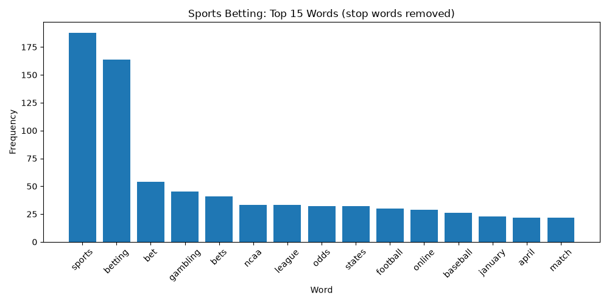

# nlp-01-getting-started

[](pyproject.toml)
[](https://github.com/jgdavis24/nlp-01-getting-started/actions/workflows/ci-python-zensical.yml)
[](https://jgdavis24.github.io/nlp-01-getting-started/)

[](https://docs.astral.sh/uv/)
[](https://docs.astral.sh/ty/)
[](https://zensical.org/)
[](LICENSE)

> Retrieve, clean, and visualize the most frequent terms in the Wikipedia article on sports betting.

## Project Overview

Author: Josiah Davis

Date: 2026 October

First project in the Web Mining and Applied NLP course.

Based on the example project
[denisecase/nlp-01-getting-started](https://github.com/denisecase/nlp-01-getting-started).

**My question:** What terms dominate a general article about sports betting,
and do league acronyms like NFL, NBA, and MLB show up
once short words are kept and filler words are removed?

I work in marketing acquisition in the online sportsbook and casino industry,
so I picked a topic where I know what the important terms should be.

The full data story is on the
[hosted documentation site](https://jgdavis24.github.io/nlp-01-getting-started/).

The project is configured in
[pyproject.toml](pyproject.toml).

## Data

The project retrieves HTML from a public web page
using the Requests library.

BeautifulSoup parses the HTML and extracts text
for analysis.

No local input dataset is required.

- Custom analysis: [Sports betting - Wikipedia](https://en.wikipedia.org/wiki/Sports_betting)
- Original example: [Natural Language Processing - Wikipedia](https://en.wikipedia.org/wiki/Natural_language_processing)

## Approach

The project uses Python to retrieve and analyze web text:

- Retrieving HTML using HTTP requests.
- Parsing HTML and extracting text with BeautifulSoup.
- Cleaning text, including a custom stop word list.
- Counting word frequencies using Polars.
- Visualizing frequent words using Matplotlib.
- Creating word clouds to explore vocabulary patterns.

Important project components:

- [src/nlp/sports_words.py](src/nlp/sports_words.py) - my custom sports betting analysis.
- [src/nlp/web_words.py](src/nlp/web_words.py) - the example analysis (with my D2 change).
- [notebooks/web_words.ipynb](notebooks/web_words.ipynb) - interactive Jupyter notebook example.
- [pyproject.toml](pyproject.toml) - project identity, dependencies, and tool configuration.
- [tests/](tests/) - automated tests.
- [.github/workflows/](.github/workflows/) - automated testing and documentation deployment.
- [docs/](docs/) - project documentation and saved charts.
- [zensical.toml](zensical.toml) - documentation configuration.

## Run the Project

Follow the [Professional Python Workflow Guide](https://denisecase.github.io/pro-analytics-02/)
to set up your machine and project environment.

From a VS Code terminal in the project root, run my custom analysis:

```shell
uv run python -m nlp.sports_words
```

Or run the original example:

```shell
uv run python -m nlp.web_words
```

Close each visualization window after viewing
so the script can continue executing.

The custom script also saves both charts to `docs/images`.

## Results

Successful execution produces:

```shell
========================
Pipeline executed successfully!
========================
```

A `project.log` file is created in the project root.

Top terms in the sports betting article:
sports (188), betting (164), bet (54), gambling (45), bets (41),
ncaa (33), league (33), odds (32), states (32), football (30).



## Verification

Run the automated tests:

```shell
uv run python -m pytest
```

## Project Documentation

The [hosted documentation site](https://jgdavis24.github.io/nlp-01-getting-started/)
is published using Zensical and GitHub Pages.

It covers the data, methods, custom modifications, results,
interpretation, limitations, and next steps.

## CI/CD and GitHub Actions

This project includes continuous integration and continuous deployment (CI/CD)
to check project files and publish the docs.

GitHub Actions include:

- [CI: Python and Documentation Checks](https://github.com/jgdavis24/nlp-01-getting-started/actions/workflows/ci-python-zensical.yml)
- [CD: Documentation Deployment](https://github.com/jgdavis24/nlp-01-getting-started/actions/workflows/deploy-zensical.yml)

## My Custom Work

### D1. Baseline

Ran the example as-is with `uv run python -m nlp.web_words` on 2026-10-30.

- Total raw words: 8,331
- Total cleaned words: 5,520
- Top words: language (111), natural (69), processing (54), text (52)
- Filler words still in the top 10: that (39), from (39), with (38), this (37), e.g (35)

The term "nlp" only shows up when punctuation is attached (like "nlp,").
The length check runs before punctuation is stripped,
so "nlp," passes as 4 characters and then gets counted as "nlp".
A plain "nlp" is only 3 characters and gets filtered out by `len(word) > 3`.

### D2. Technical Modification

**Change:** In `src/nlp/web_words.py`, lowered the minimum word length
from `len(word) > 3` to `len(word) > 2`.

**Why:** The baseline was dropping "nlp", the main acronym for the topic of the page.

**Prediction:** [PASTE YOUR PREDICTION LINE BACK HERE]

**Result:**

- Total cleaned words went from 5,520 to 6,415 (+895)
- "nlp" now counts 43 and is 8th in the top 10
- "the" (299) and "and" (156) took over the top two spots, and "for" (50) entered the top 10
- Topic words did not change: language (111), natural (69), processing (54), text (52)

**What I learned:** A length cutoff is a tradeoff.
Lowering it kept a short term that matters but also let in short filler words.
Length alone cannot tell the difference, so a stop word list is needed to remove filler
while keeping meaningful short terms.

### D3. Custom Application

Applied the same techniques to the
[Sports betting](https://en.wikipedia.org/wiki/Sports_betting) article
in [src/nlp/sports_words.py](src/nlp/sports_words.py):

- Strips punctuation before the length check (fixes the D1 issue).
- Keeps words longer than 2 characters so league acronyms survive (from D2).
- Removes a stop word list of filler words and Wikipedia page text.
- Drops digit-only tokens like years.
- Saves the charts to `docs/images` for the documentation site.

Result: 10,724 raw words, 6,115 cleaned words.
The article leans legal and regulatory ("states", "online", "legal", "PASPA"),
and NCAA (33) ranks above every pro league.
Full write-up on the [documentation site](https://jgdavis24.github.io/nlp-01-getting-started/).

## Developer Reference

Follow the
[Professional Python Workflow Guide](https://denisecase.github.io/pro-analytics-02/)
for **detailed instructions and troubleshooting**.

### Initialize and Update the Python Environment

With the project open in VS Code, open a VS Code terminal.
Paste each command and hit Enter or Return after to run it.

```shell
uvx pup-clean --delete
uv self update
uv python pin 3.14
uv python install
uv lock --upgrade
uv sync
uv audit
```

### Set Up and Run Git Hooks

Set up and run the git hooks to perform
basic checks automatically before
any changes get pushed to GitHub.

In the VS Code terminal,
paste each command and hit Enter or Return after to run it.

```shell
uvx prek install --force
uvx prek update --freeze --cooldown-days 7

git add -A
uvx prek run --all-files
# repeat if changes were made
uvx prek run --all-files
```

### Run Common Chores

Run linters, formatters, type checks, tests, and
build the documentation.

```shell
uv run ruff check . --fix
uv run ruff format .

uv run ty check
uv run python -m pytest
uv run python -m zensical build
```

### Git add-commit-push to GitHub

After making useful changes, save your work to GitHub.

```shell
git add -A
git commit -m "describe your changes in quotes"
git push -u origin main
```

## Developer Notes

- Use the **UP ARROW** and **DOWN ARROW** in the terminal to scroll through past commands.
- Use `CTRL+f` to find (and replace) text within a file.

## Developer Tools

This project uses professional Python tools to support development,
testing, documentation, and code quality.

- [uv](https://docs.astral.sh/uv/) - Python environments and dependencies.
- [Ruff](https://docs.astral.sh/ruff/) - Python linting and formatting, configured in [.ruff.toml](.ruff.toml).
- [ty](https://docs.astral.sh/ty/) - Python type checking.
- [pytest](https://docs.pytest.org/) - automated Python testing, configured in [.pytest.toml](.pytest.toml).
- [prek](https://prek.j178.dev/) - Git hooks and automated checks, configured in [prek.toml](prek.toml).
- [Zensical](https://zensical.org/) - project documentation, configured in [zensical.toml](zensical.toml).

## Links

- [Hosted Documentation](https://jgdavis24.github.io/nlp-01-getting-started/)
- [Data Source: Sports betting - Wikipedia](https://en.wikipedia.org/wiki/Sports_betting)
- [Original Example Project](https://github.com/denisecase/nlp-01-getting-started)
- [Professional Python Workflow Guide](https://denisecase.github.io/pro-analytics-02/)
- [AI Use Statement](AI_USE.md)
- [Citation](CITATION.cff)
- [License](LICENSE)
