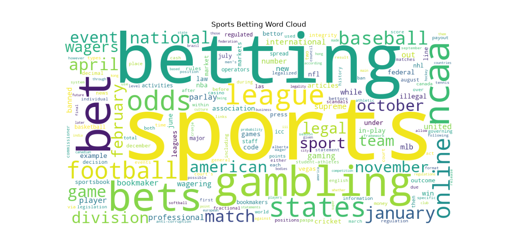

# Web Mining and Applied NLP Project Report

Web Mining and Applied NLP | Project 01 | Josiah Davis | 2026-10

## Overview

This project adapts the example web mining project to a new page:
the Wikipedia article on **Sports betting**.

The question: what terms dominate a general article about sports betting,
and do league acronyms like NFL, NBA, and MLB show up
once short words are kept and filler words are removed?

I work in marketing acquisition in the online sportsbook and casino industry,
so this is a topic where I know what the important terms should be.

## Data

- Source: [Sports betting - Wikipedia](https://en.wikipedia.org/wiki/Sports_betting)
- Accessed: 2026-10-30
- Downloaded: 454,443 characters of HTML
- Total raw words: 10,724
- Total cleaned words: 6,115

No local dataset is stored. The page is retrieved live each run,
so counts may change if the article is edited.

## Tools and Methods

The project uses:

- Python for text acquisition and analysis.
- Requests for retrieving HTML from web pages.
- BeautifulSoup for parsing HTML and extracting text.
- Polars for computing word frequencies.
- Matplotlib for frequency visualizations.
- WordCloud for visual exploration of vocabulary.
- Logging for execution records.
- Ruff, ty, and pytest for code verification.
- Zensical and GitHub Pages for published documentation.

The custom script is
[src/nlp/sports_words.py](https://github.com/jgdavis24/nlp-01-getting-started/blob/main/src/nlp/sports_words.py).

Run it from the project root with:

    uv run python -m nlp.sports_words

## Custom Modifications

### D1. Baseline

The original example on the Natural Language Processing page produced
5,520 cleaned words. Top words were language (111), natural (69),
processing (54), and text (52). Filler words like that, from, with,
and this were still in the top 10.

A plain "nlp" was being dropped because the filter only keeps words
longer than 3 characters. It only slipped through when punctuation
was attached ("nlp,") because the length check ran before punctuation
was stripped.

### D2. Technical Experiment

I lowered the minimum word length from `> 3` to `> 2` in `web_words.py`.

- "nlp" came back with 43 occurrences (8th place)
- Cleaned words went from 5,520 to 6,415
- But "the" (299) and "and" (156) took over the top two spots

Lesson: length alone cannot separate short words that matter
from short filler words. A stop word list is needed.

### D3. Custom Application

Changes in `sports_words.py` compared to the example:

1. New page: Sports betting instead of Natural language processing.
2. Punctuation is stripped **before** the length check, fixing the "nlp," issue from D1.
3. Words longer than 2 characters are kept so league acronyms survive.
4. A stop word list removes filler words and Wikipedia page text
   (edit, retrieved, archived, isbn, and similar).
5. Tokens that are only digits (years, page numbers) are removed.
6. The top 15 words are charted instead of 10.
7. Both charts are saved to `docs/images` so they display on this page.

## Results

Top words after cleaning:

| Rank | Word | Count |
|---|---|---|
| 1 | sports | 188 |
| 2 | betting | 164 |
| 3 | bet | 54 |
| 4 | gambling | 45 |
| 5 | bets | 41 |
| 6 | ncaa | 33 |
| 7 | league | 33 |
| 8 | odds | 32 |
| 9 | states | 32 |
| 10 | football | 30 |
| 11 | online | 29 |
| 12 | baseball | 26 |

## Verification

A successful execution displays:

    Pipeline executed successfully!

The script records execution details in a project log.
GitHub Actions run the project checks on every push.

## Interpretation

- **The article leans legal and regulatory.**
  "States" (32) and "online" (29) are in the top 11,
  and legal, federal, illegal, and PASPA all appear in the word cloud.
  That matches how the US market actually grew, one state at a time.
- **College sports show up more than any pro league.**
  "NCAA" (33) ties for 6th, while NFL, NBA, MLB, and NHL survived
  the filter but are much smaller. Words like "division" and
  "student-athletes" suggest a lot of the article covers college betting rules.
- **Keeping 3-letter words was the right call.**
  Without the D2 change, ncaa would survive but nfl, nba, mlb, and nhl would all be dropped.

## Limitations

- One page only, and it is a live page that can change.
- No stemming, so bet, bets, and betting are counted as three different words.
- Month names (january 23, april 22) are mostly from citation dates, not article content.
- The stop word list was built by hand from what showed up, so it is specific to this page.
- Word counts show what is mentioned most, not context or sentiment.

## Next Steps

- Combine word forms (bet, bets, betting) with stemming or lemmatization.
- Pull only the main article body instead of the full page.
- Compare this page to a sportsbook's promo or help pages to see how the language differs.
- Count phrases like "sports betting" and "point spread" instead of single words.

## Documentation Index

- **Home** - this landing page
- [**Project Instructions**](project-instructions.md)
- [**Glossary**](glossary.md)

## Project Links

- [GitHub Repository](https://github.com/jgdavis24/nlp-01-getting-started)
- [Custom Script: sports_words.py](https://github.com/jgdavis24/nlp-01-getting-started/blob/main/src/nlp/sports_words.py)
- [Example Script: web_words.py](https://github.com/jgdavis24/nlp-01-getting-started/blob/main/src/nlp/web_words.py)
- [Original Example Project](https://github.com/denisecase/nlp-01-getting-started)
- [Data Source: Sports betting - Wikipedia](https://en.wikipedia.org/wiki/Sports_betting)

## Project Resources

- [Project Instructions](project-instructions.md)
- [Professional Python Guide](https://denisecase.github.io/pro-analytics-02/)
- [Professional Python Project Explainer](https://pup-pack.github.io/professional-python-project-explainer/)
